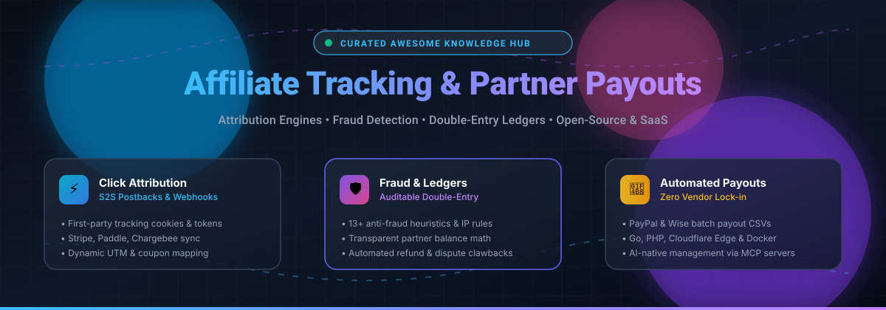
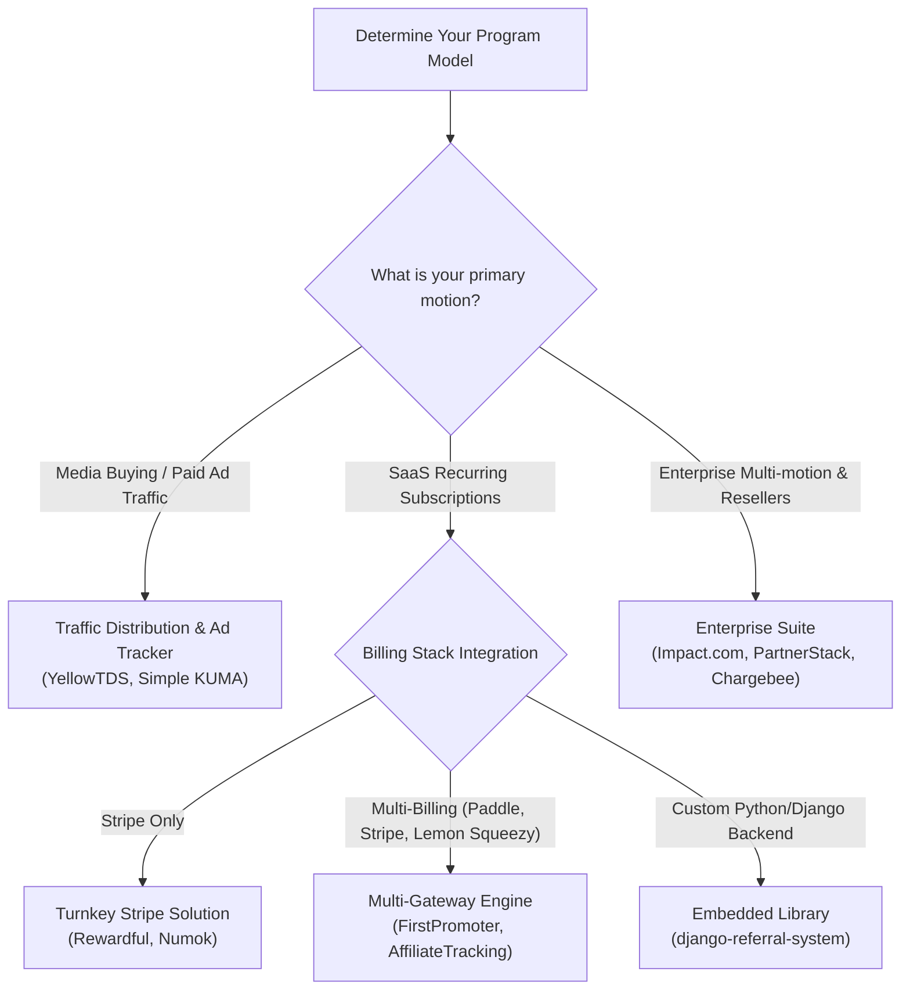

# Awesome Affiliate Tracking & Partner Payouts 

  

> 🚀 A curated list of leading SaaS affiliate management software and open-source GitHub projects focused on click attribution, commission management, fraud detection, and self-hosted partner payouts.

    

---

## 📈 Sector Overview & Market Dynamics

The global affiliate marketing and partnership management software market is estimated at **$12.2 billion to $22.6 billion in 2024–2025**, projected to surpass **$40+ billion by 2030** with an approximate 9–11% CAGR driven by e-commerce expansion and creator-led commerce.

The sector exhibits a **moderately fragmented, bifurcated structure**: enterprise tiers are concentrated around a handful of heavyweight partner automation suites (e.g., Chargebee, Impact.com, TUNE), while the mid-market and SMB tiers remain highly fragmented with specialized point solutions (Stripe-native SaaS tools, self-hosted open-source engines, and ad-buyer trackers) competing on commission transparency, developer flexibility, and fraud mitigation.

---

## 📑 Table of Contents

- [📈 Sector Overview & Market Dynamics](#-sector-overview--market-dynamics)
- [💼 SaaS & Hosted Platforms](#-saas--hosted-platforms)
- [🔓 Open-Source GitHub Projects](#-open-source-github-projects)
- [🏗️ Architectural Comparison & Use Cases](#️-architectural-comparison--use-cases)
- [⭐ Star History](#-star-history)
- [💖 Support](#-support)
- [🤝 How to Contribute](#-how-to-contribute)
- [⚠️ Disclaimer](#️-disclaimer)

---

## 💼 SaaS & Hosted Platforms

The table below lists top commercial SaaS platforms for affiliate program administration, multi-channel partner attribution, and automated payout disbursement, sorted in descending order by estimated company valuation / annual recurring revenue scale.

| Platform | Valuation / Company Scale | Starting Pricing | Free Tier Limits / Trial Limits | Key Focus & Capabilities |
| :--- | :--- | :--- | :--- | :--- |
| **[Chargebee](https://www.chargebee.com/)** | $3.5B Valuation (~$202M ARR) | $599/month (Performance plan; billed annually at $7,188/yr) | Free tier available up to $250,000 in cumulative lifetime billing (0.75% overage fee thereafter); integrates with affiliate engines (FirstPromoter, Tolt, Rekomi) | 💳 Subscription billing platform with built-in referral rules, recurring revenue attribution, and tax-compliant payout operations. |
| **[Impact.com](https://impact.com/)** | $1.5B Valuation (~$270M ARR) | $30/month (Starter tier) to $500/month (Essentials) | 30-day free trial on self-serve Starter plan (credit card required; no permanent free tier for merchants; free for publishers/creators to join marketplace) | 🌐 Enterprise partnership ecosystem management across classic affiliates, media publishers, influencers, and B2B tech partners with automated contract compliance. |
| **[TUNE](https://www.tune.com/)** (formerly HasOffers) | ~$200M Parent Group Scale (LON: TUNE / ~£133M market cap) | $899/month (Network Enterprise tier; billed annually) or $1,500/month (Advertiser Scale tier) | No free tier or self-serve free trial; guided sandboxed product demo available upon sales qualification | 📡 Performance marketing network and advertiser platform supporting real-time attribution, server-to-server (S2S) postbacks, and 2-way REST APIs. |
| **[Everflow](https://www.everflow.io/)** | ~$30M+ ARR ($4.3B+ tracked GMV) | $750/month (Core / Starter tier with contract commitment) | No free tier or self-serve free trial; personalized live walkthrough and sandbox demo upon qualification | 📊 High-throughput partner marketing, smart link routing, automated anti-fraud click scoring, and deep multi-channel attribution. |
| **[PartnerStack](https://www.partnerstack.com/)** | ~$29M+ Venture Funding ($2.7B+ all-time GMV) | $0/month subscription (PartnerStack Spark tier with 10% payout transaction fee) | Spark self-serve plan has $0/month subscription fee (10% fee on affiliate payouts); 14-day guided trial for Enterprise & Growth tiers | 🤝 B2B SaaS partnership management engine covering affiliate networks, reseller agreements, agency co-selling, and marketplace discovery. |
| **[Refersion](https://www.refersion.com/)** | ~$3.4M–$5.3M ARR ($2B+ tracked GMV) | $39/month (Starter tier, up to 50 monthly affiliate orders) | 14-day free trial on paid plans; free tier available limited to Refersion Marketplace listing | 🛍️ E-commerce affiliate and influencer tracking optimized for Shopify, BigCommerce, and WooCommerce stores with coupon-code attribution. |
| **[Rewardful](https://www.rewardful.com/)** | ~$2.8M ARR ($68M+ tracked client revenue) | $49/month (Starter tier, up to $7,500 monthly affiliate revenue) | 14-day free trial with full platform access; no permanent free tier | ⚡ Turnkey Stripe-native affiliate and referral platform designed specifically for SaaS recurring subscriptions and automated commission refunds. |
| **[FirstPromoter](https://firstpromoter.com/)** | ~$30M+ Tracked Partner Volume/mo | $49/month (Starter tier, up to $5,000 monthly affiliate revenue) | 14-day free trial (no credit card required, full feature access, up to 1,000 affiliates and 2 campaigns); no permanent free tier | 🔌 Multi-provider subscription affiliate tool integrating with Stripe, Paddle, Chargebee, Recurly, and Braintree with customizable affiliate portals. |
| **[Tapfiliate](https://tapfiliate.com/)** | ~$580K–$960K ARR (Admitad Group) | $89/month (Launch plan, up to $10,000 affiliate volume) | 7-day free trial on Launch plan; 14-day free trial on Scale plan ($179/month); no permanent free tier | 🎯 Multi-tier commission management, MLM support, white-label partner dashboards, and flexible REST API hooks for e-commerce and SaaS. |
| **[LeadDyno](https://www.leaddyno.com/)** | High-volume SMB Merchant Base | $49/month (Starter tier, up to 3,000 unique monthly visitors) | 30-day free trial with full access; no permanent free tier | 📣 Fast setup affiliate and referral system featuring social sharing widgets, automated email campaigns, and one-click PayPal mass payout generation. |

---

## 🔓 Open-Source GitHub Projects

Self-hosted, transparent, and auditable open-source alternatives to proprietary affiliate SaaS platforms. Repositories are ranked below in descending order by GitHub stargazers count, with live badges linking directly to their stargazer community pages.

| Repository | GitHub_Stars | Tech Stack | License | Core Capabilities & Architecture |
| :--- | :--- | :--- | :--- | :--- |
| **[BranchMetrics/ios-branch-deep-linking-attribution](https://github.com/BranchMetrics/ios-branch-deep-linking-attribution)** |  | Objective-C / Swift | Apache-2.0 | 📱 Mobile app deep linking, click-to-install attribution, deferred deep linking, and referral tracking infrastructure across mobile user acquisition funnels. |
| **[dvygolov/YellowTDS](https://github.com/dvygolov/YellowTDS)** |  | PHP / MySQL | Open Source | 🚦 High-speed traffic distribution system (TDS) for affiliate marketing, click routing, geo-targeting, bot filtration, and dynamic landing page split testing. |
| **[amicalhq/refref](https://github.com/amicalhq/refref)** |  | TypeScript / Node.js | AGPL-3.0 | 🧩 Modern open-source referral and affiliate marketing platform designed as a self-hosted alternative to Refersion and Tolt, with JS tracking snippet and partner portal. |
| **[Refferq/Refferq](https://github.com/Refferq/Refferq)** |  | TypeScript / React / Node.js | MIT | 🚀 Self-hostable referral and affiliate platform tailored for SaaS startups, featuring automated partner invitation links, reward triggers, and webhook management. |
| **[timbru31/amazon-tag-remover](https://github.com/timbru31/amazon-tag-remover)** |  | JavaScript / WebExtensions | MIT | 🛡️ Open-source browser extension engine that strips affiliate tracking tags, UTM codes, and affiliate parameters for ad-tech transparency and privacy research. |
| **[intelliants/elitius](https://github.com/intelliants/elitius)** |  | PHP / MySQL | GPL-2.0 | 🏛️ Established self-hosted affiliate tracking system with template customization, banner impression counting, commission calculations, and affiliate dashboard. |
| **[dfg-ar/numok](https://github.com/dfg-ar/numok)** |  | PHP 8.1+ / MySQL / Docker | MIT | 💳 Stripe-native affiliate program software that provisions dedicated partner portals, listens for Stripe webhook charges/refunds, and manages payout summaries. |
| **[soldatov-ss/django-referral-system](https://github.com/soldatov-ss/django-referral-system)** |  | Python / Django | MIT | 🐍 Pluggable Django referral and affiliate library providing promoter registration, referral link tracking, commission accrual, click analytics, and Wise CSV export. |
| **[kumatrk/initialrelease](https://github.com/kumatrk/initialrelease)** (Simple KUMA) |  | PHP / MySQL | AGPL-3.0 | 🎯 Self-hosted performance tracker and media-buyer engine with Meta Ads and Google Ads cost sync, campaign rotation, S2S conversion postbacks, and REST API. |
| **[ZAK123DSFDF/refearnapp](https://github.com/ZAK123DSFDF/refearnapp)** |  | Next.js / Cloudflare / Drizzle | AGPL-3.0 | ⚡ High-scale affiliate tracking and referral management app built for speed on Cloudflare Edge, providing real-time click attribution and Docker deployment. |
| **[thebigasif/affiliate-tracking](https://github.com/thebigasif/affiliate-tracking)** |  | Go / SQLite / Postgres | AGPL-3.0 | 🔒 Comprehensive self-hosted affiliate engine: 13 anti-fraud rules, multi-billing webhooks (Stripe, Paddle, Chargebee, Lemon Squeezy), double-entry ledger, PayPal/Wise payouts, and MCP server. |
| **[prathammahajan13/affiliate-management-system](https://github.com/prathammahajan13/affiliate-management-system)** |  | Node.js / TypeScript | MIT | 📦 Production-ready affiliate management system with multi-tier commission workflows, payout batching, fraud prevention, and merchant analytics. |
| **[UjjwalSaini07/Affiliate-Postback-Engine](https://github.com/UjjwalSaini07/Affiliate-Postback-Engine)** |  | Next.js / Express / PostgreSQL | MIT | 🔄 S2S affiliate postback engine and tracking URL generator for recording clicks, attribution callbacks, and affiliate conversion transactions. |
| **[Cap-go/Capve](https://github.com/Cap-go/Capve)** |  | React / Cloudflare Workers / D1 | Open Source | 🌐 Edge-hosted affiliate and campaign tracker deployable on Cloudflare Workers, featuring anti-fraud blocklists, postbacks, and 92 MCP tools for AI management. |

---

## 🏗️ Architectural Comparison & Use Cases

Choosing between SaaS platforms and self-hosted open-source software depends on compliance posture, billing stack, and whether your program focuses on performance media buying or recurring SaaS subscriptions:

### 1. 🏢 Enterprise Partner Automation vs. Indie SaaS Tools
* **Impact.com & PartnerStack** excel when you need cross-organization partner discovery, co-selling CRM integrations (Salesforce, HubSpot), and global tax document collection (W-8/W-9) across thousands of affiliates worldwide.
* **Rewardful & FirstPromoter** represent the benchmark for early-to-growth SaaS founders seeking 5-minute Stripe/Paddle integration, customer churn attribution, and automatic recurring affiliate payouts.

### 2. ⚙️ Full Affiliate Engine vs. Media-Buyer Tracker
* **Full Affiliate Platforms ([thebigasif/affiliate-tracking](https://github.com/thebigasif/affiliate-tracking), [amicalhq/refref](https://github.com/amicalhq/refref), [dfg-ar/numok](https://github.com/dfg-ar/numok)):** Handle recurring subscription attribution, refund clawbacks, double-entry ledgers, and automated mass-payout file generation (PayPal Payouts, Wise batch payments).
* **Media-Buyer & Ad Trackers ([kumatrk/initialrelease](https://github.com/kumatrk/initialrelease), [dvygolov/YellowTDS](https://github.com/dvygolov/YellowTDS)):** Built for traffic arbitrage, server-to-server (S2S) postbacks, cost-sync with Meta and Google Ads APIs, and high-frequency redirection.

### 3. 🤖 Edge-Native and AI-Enabled Operations
* Next-generation engines like **Capve** and **thebigasif/affiliate-tracking** embed **Model Context Protocol (MCP)** servers, enabling engineering and growth teams to audit partner conversions, adjust commission tiers, and flag fraud vectors directly via AI agent interfaces (Claude Code, Cursor, Windsurf).

---

## 🌟 Star History

---

## 💖 Support

A huge thank you to everyone exploring, using, and building transparent tracking and partner infrastructure! If you find this curated list helpful, please consider:

- ⭐ **Starring** the repository to boost visibility.
- 🍴 **Forking** it to keep a copy or prepare your contributions.
- 📢 **Sharing** it with affiliate managers, growth engineers, and open-source communities.
- ☕ **Sponsoring** continued research and updates via the [GitHub Sponsors Dashboard](https://github.com/sponsors/ishandutta2007).

---

## 🤝 How to Contribute

Contributions, project suggestions, and documentation improvements are welcome!

1. 🍴 Fork this repository.
2. 🌿 Create a descriptive branch: `git checkout -b add-my-affiliate-tool`.
3. 📝 Add your tool to `README.md` keeping the Markdown tabular format, ensuring exact pricing and free tier/trial limits are stated.
4. 🔗 Verify all GitHub open-source links include live social stargazer badges linking to `/stargazers`.
5. 🚀 Open a Pull Request with a short summary of the addition.

---

## ⚠️ Disclaimer

- This curated list is maintained for educational and architectural evaluation purposes. Mention of commercial products or open-source projects does not constitute an endorsement.
- Storing affiliate records, tracking cookies, and processing partner commission payouts involves handling personal identifiable information (PII) and financial data. Always ensure compliance with GDPR, CCPA, ePrivacy regulations, and local tax requirements prior to deploying production payout infrastructure.
